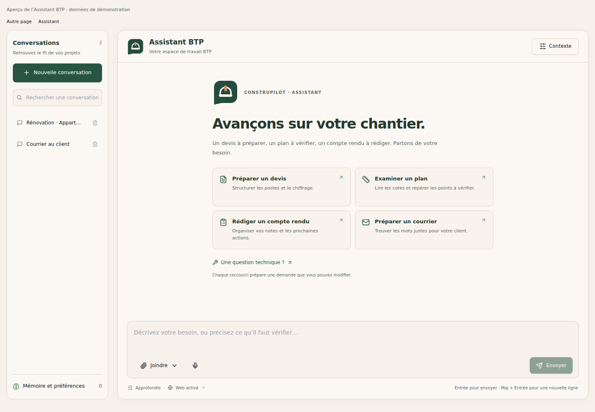
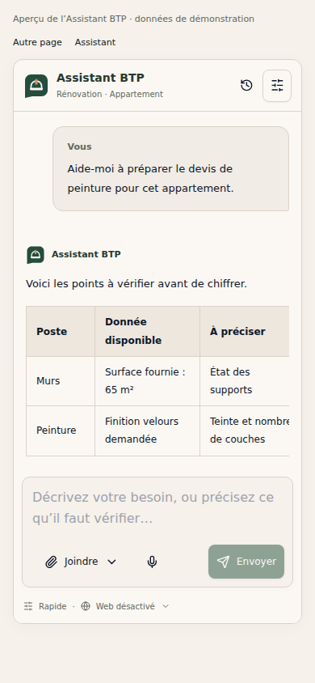

# Assistant BTP — interface, collaboration et arrière-plan

## Changements

- Identité vectorielle commune à la navigation, à l’accueil et aux réponses : bulle de conversation et casque, vert profond, ivoire et cuivre.
- Interface beige sobre, historique recherchable, quatre raccourcis éditables, documents et réglages regroupés, commande « Joindre » unique, mode de réponse et recherche web visibles.
- Zone de saisie maintenue à l’écran ; panneaux du dossier dans le fil défilant ; réponses, tableaux, thèmes clair/sombre et écrans étroits revus. Les tableaux défilent horizontalement dans une région accessible au clavier.
- Instructions communes aux fournisseurs existants : comprendre la demande, exploiter le dossier, réaliser les étapes autorisées, vérifier les calculs et sources, poser une question seulement quand le manque bloque le résultat, rapporter les limites et résultats réellement obtenus. Les permissions et confirmations des outils sont conservées.
- Correction du contexte : une page ou une zone lue ne marque plus tout le document comme lu/validé. Une action échouée ou simplement mise en file ne constitue plus une preuve de lecture. Les calculs réussis conservent résultat, unité et provenance ; une correction permet la relecture/recalcul des parties concernées.

## Continuité en arrière-plan

Le moteur existant met les demandes en file MongoDB et les exécute dans des workers du serveur. La page ne fait que suivre le résultat ; son démontage n’annule pas le travail.

Cette modification complète ce fonctionnement :

1. La conversation est mémorisée dès l’accusé de réception du serveur, même si l’utilisateur a quitté l’Assistant entre-temps.
2. Un indicateur dans la navigation commune suit les tâches actives et permet de revenir à la conversation depuis une autre page. Le flux est limité à l’utilisateur connecté et ne contient ni messages ni pièces jointes.
3. Le retour recharge la progression et les messages conservés sur le serveur. Les lectures du suivi ne déclenchent aucun nouvel envoi.
4. Une réponse partielle n’efface plus l’état interrompu ni l’action de reprise. Un résultat partiel conservé uniquement dans le job reste consultable.
5. Les nouvelles notifications possèdent l’identifiant attendu par la cloche pour être marquées comme lues. La finalisation reste idempotente.
6. La soumission de jobs applique le même niveau d’accès que l’Assistant ; l’utilisateur conserve l’accès au suivi et à l’arrêt de ses tâches existantes. Un index utilisateur/état/date soutient le suivi global.

Changer de page et perdre un worker serveur sont deux situations différentes : une tâche en cours dont le worker disparaît est marquée interrompue, avec les résultats partiels disponibles. Elle n’est pas rejouée automatiquement, car un outil peut déjà avoir créé un document ou consommé une opération payante. Les demandes encore en file persistent ; leur exécution nécessite un serveur et des workers disponibles.

## Vérification

- **42 tests Python réussis**, dont 15 nouveaux : contexte partiel, calcul nul, provenance, deux types de comptes, idempotence, isolation utilisateur, ordre de la file, verrou par conversation, flux de suivi sans données privées, worker sans navigateur, notification, annulation explicite, bail expiré et arrêt du worker avec réponse partielle.
- Page réelle et navigation commune compilées et exercées dans Chromium avec services locaux simulés : raccourcis, sélection/retrait de pièces, mode/web dans la demande, correction, import, historique, clavier/focus, 390/320 px, portugais, thèmes clair et sombre.
- Scénario de navigation : quitter avant l’accusé de réception, voir l’activité depuis une autre page, revenir pendant le travail, repartir, terminer, récupérer la réponse et conserver un seul envoi sans annulation implicite. L’état interrompu reste visible après enregistrement d’une réponse partielle.
- Contrôle statique de 402 fichiers JavaScript/JSX sans erreur de syntaxe ou nom non défini détecté ; compilation des modules Python modifiés.

Reproduction depuis la racine du dépôt, avec les dépendances backend installées :

```sh
python backend/scripts/test_assistant_regressions.py
```

Le script désactive les fournisseurs externes et utilise les routes réelles avec des bases en mémoire. Le scénario navigateur est dans `frontend/scripts/test-assistant-studio.cjs` ; il nécessite les dépendances frontend, esbuild, Playwright et Chromium. `NODE_PATH` permet un répertoire de dépendances séparé ; `CHROMIUM_EXECUTABLE_PATH` un navigateur existant ; `ASSISTANT_PREVIEW_DIR` le dossier de sortie.

```sh
node frontend/scripts/test-assistant-studio.cjs
```

Les captures utilisent des données de démonstration et des réponses simulées. Elles ne mesurent pas la qualité d’un modèle. Aucune conversation cliente, base de production ou API IA payante n’a été utilisée pour ces tests. Restent à valider en préproduction : application complète, MongoDB réel, fournisseurs IA, notifications et reprise après redémarrage du service. La précision de métré de 98 % reste à mesurer sur un corpus annoté ; ces changements ne la démontrent pas et ne reproduisent pas à eux seuls toutes les capacités de ChatGPT.

## Aperçus




