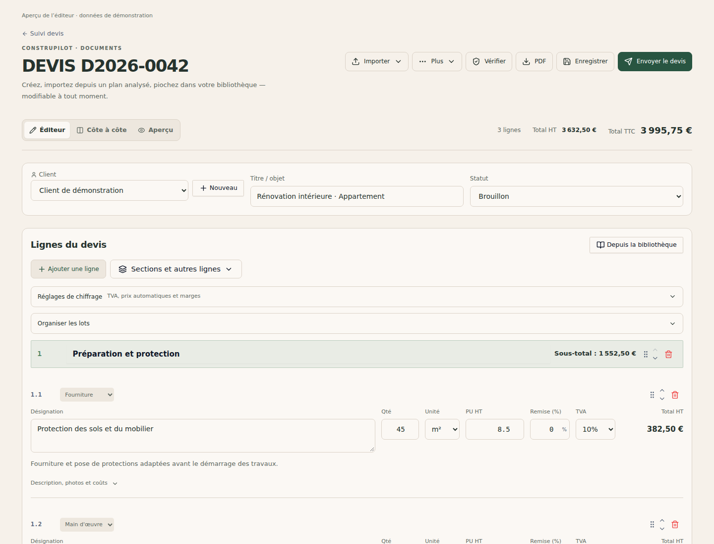

# Éditeur de devis : présentation simplifiée

## Changements

- Palette beige sable clair et cartes ivoire, hiérarchie visuelle allégée et champs plus lisibles. Les couleurs de surface suivent le thème commun de la plateforme.
- Imports regroupés dans « Importer », modèles et actions secondaires dans « Plus ».
- Enregistrer, vérifier, exporter le PDF et envoyer restent accessibles dans l'en-tête.
- Quantités, unités, prix, remises et TVA portent un libellé visible ; les désignations acceptent plusieurs lignes.
- Les totaux HT et TTC sont visibles en haut. Une TVA manquante conserve son avertissement.
- Réglages avancés, organisation des lots et édition des descriptions/coûts accessibles à la demande.
- Sections et échéancier adaptés aux écrans étroits ; aperçu papier blanc et thème sombre conservés.

Le calcul des montants, les appels API et les fonctions de sauvegarde existants sont inchangés. Le fichier de styles est limité à cet éditeur et à ses menus.

## Vérification locale

La page réelle et ses composants ont été compilés avec esbuild/Tailwind et exécutés sous Chromium. Seuls l'API et les contextes de compte, langue et chantier étaient simulés. Aucun document réel n'a été modifié ni envoyé.

- Ouverture des menus, navigation clavier, sélecteur de fichier CCTP et dialogue des modèles.
- Saisie de quantité, prix, remise et TVA : total de ligne attendu de 450,00 € HT et total document attendu de 4 115,00 € TTC sur le jeu de démonstration.
- Édition de description et coût, ajout de texte, contenu sauvegardé dans l'API simulée et cohérence de l'aperçu.
- Éditeur, aperçu, vue côte à côte, thème sombre et variante facture.
- Absence de débordement horizontal à 390 et 320 px ; largeur des titres de section contrôlée.
- Aucune erreur JavaScript navigateur ; 398 fichiers JS/JSX contrôlés pour syntaxe et noms non définis, sans erreur détectée.
- Comparaison du code métier avant/après : inchangé.

Limites : vérification isolée de l'éditeur, sans build de l'application entière ni service réel. La génération PDF serveur, l'envoi d'e-mails et les imports IA n'ont pas été exécutés. Une recette en préproduction reste nécessaire avant déploiement.
