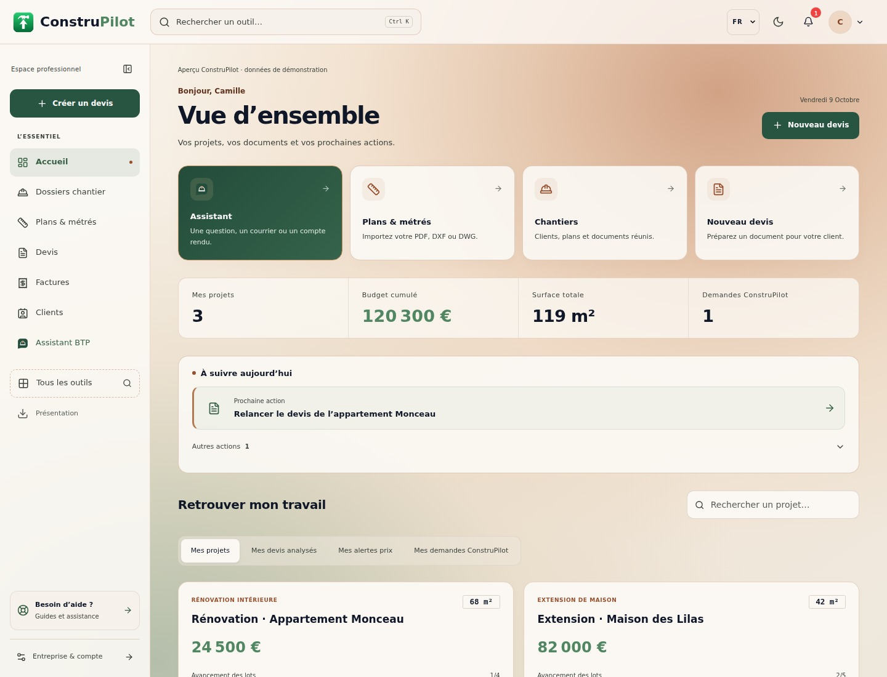
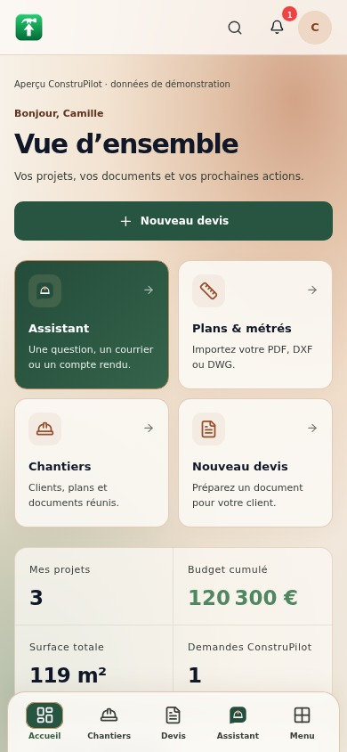

# Fond vivant beige, cuivre et vert

Cette itération répond à la demande d’un cuivre plus visible et d’un fond dynamique inspiré de l’interface Gemini sur Android. Elle remplace le fond uni de l’espace connecté par des halos cuivre et vert sur une base ivoire, sans reprendre les couleurs ni les assets de Google.

## Rendu et fonctionnement

- Deux couches décoratives se déplacent lentement, sur des cycles de 24 et 30 secondes. Le texte, les cartes et les commandes restent immobiles. Les bordures, icônes et détails reprennent davantage le cuivre ; les actions principales restent vertes.
- Les textes secondaires sont assombris en mode clair pour rester lisibles sur le fond coloré. Les panneaux de lecture gardent un fond majoritairement opaque. Le mode sombre possède ses propres halos et couleurs de texte.
- L’animation est CSS, sans vidéo téléchargée, bibliothèque supplémentaire, suivi du pointeur ni boucle JavaScript. Elle n’intercepte aucun clic. Elle se met en pause lorsque l’onglet est masqué.
- Le menu des outils propose « Fond animé » : la pause est mémorisée sur l’appareil. La préférence système de réduction des animations prévaut. Les effets sont masqués à l’impression et en mode de couleurs forcées.
- Le fond est partagé par les pages utilisant la navigation de l’espace connecté, y compris l’Assistant. Les pages publiques et les calculs métier ne sont pas modifiés.

## Vérifications

- Scénario Chromium de l’interface commune réussi : navigation, menus, recherche, favoris, permissions, formulaires Clients/Chantiers simulés, écrans 320/390/768/1440 px, thèmes et portugais.
- Mouvement réellement observé dans le navigateur ; pause, conservation après rechargement, changement de préférence système, absence d’interception des clics et masquage à l’impression vérifiés.
- Scénario existant de l’Assistant réussi : navigation et suivi du traitement depuis une autre page, absence de double envoi et état interrompu conservé. L’ordre des imports CSS du scénario est aligné sur celui de l’application.
- Contrôle statique JavaScript/JSX sans erreur de syntaxe ou nom non défini détecté.

Les captures et l’enregistrement utilisent des données de démonstration et des API simulées. Aucun service de production ni modèle IA n’a été appelé. Les performances sur téléphones physiques et le build de production complet restent à vérifier ; les changements sont sur la branche de revue, sans déploiement.

Reproduction : `node frontend/scripts/test-workspace-design.cjs`, avec les dépendances décrites dans le rapport de l’interface générale. `WORKSPACE_RECORD_MOTION=1` ajoute un enregistrement réel de dix secondes et nécessite le FFmpeg de Playwright. La vidéo jointe en conserve huit secondes, à vitesse normale.

## Aperçus

[Voir le fond animé sur smartphone](../previews/workspace-copper-mobile.mp4)
