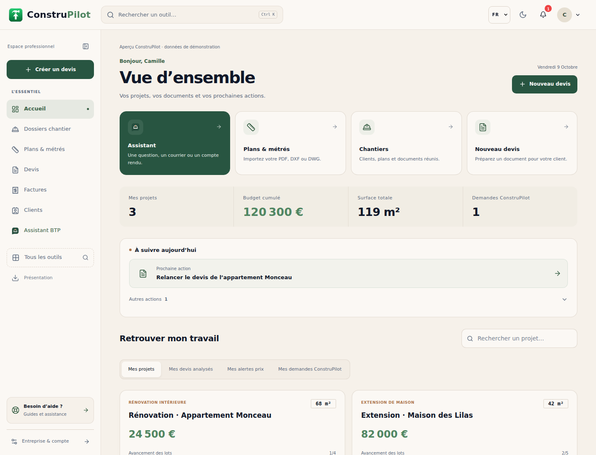
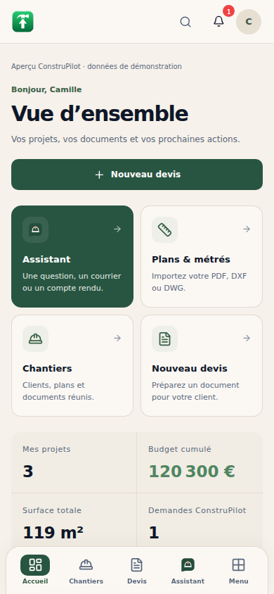
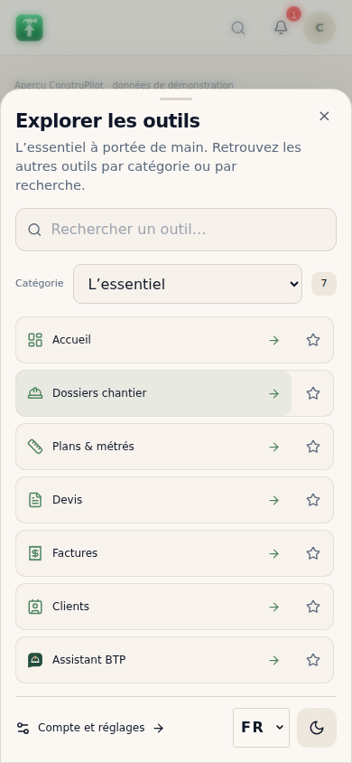

# Interface générale ConstruPilot — ordinateur et smartphone

## Changements

- Palette existante conservée : beige chaud, vert et accents cuivre. Surfaces, boutons, espacements et titres harmonisés dans l’espace connecté ; thème sombre conservé.
- Navigation organisée autour des outils quotidiens. Les outils spécialisés restent accessibles par recherche, catégorie ou favoris, avec les mêmes droits d’accès et niveaux d’abonnement.
- Accueil centré sur les actions et les projets : raccourcis, indicateurs lisibles, prochaine action, progression des lots et recherche. Les offres commerciales sont déplacées après le travail en cours.
- Sur smartphone : barre de navigation basse, compte accessible dans l’en-tête et menu des outils ouvrant depuis le bas. Le menu ne déclenche pas automatiquement le clavier ; les formulaires restent défilants dans une fenêtre courte.
- Listes Clients et Chantiers allégées, statuts et compteurs explicités, coordonnées cliquables et libellés de champs associés. Les fenêtres de saisie s’adaptent aux petits écrans.
- Pied de page de l’espace connecté réduit aux liens utiles. La page publique conserve son pied de page existant.
- Deux corrections accompagnent cette refonte : fusion des états de chargement du tableau de bord pour éviter d’écraser le chargement des projets ; retour à la ligne de la barre d’ajout de l’éditeur de devis à 320 px. L’onglet Devis reste actif sur les routes de l’éditeur.
- Les nouveaux textes communs sont disponibles en français, portugais et anglais. Cela ne constitue pas une retraduction de toute la plateforme.

## Vérification

Pages réelles compilées et exercées dans Chromium avec authentification et services locaux simulés :

- Navigation essentielle, catégories, recherche, favoris, raccourci Ctrl K, Entrée, Échap et retour du focus ; menu accessible lorsque la barre latérale est repliée.
- Accès limités selon les permissions et les abonnements ; actions professionnelles absentes pour un compte gratuit.
- Recherche de projets, affichage des indicateurs, filtres de chantiers et saisie de vrais formulaires Clients et Chantiers vers des API simulées, avec vérification du contenu envoyé.
- Écrans de 320, 390, 768 et 1440 px ; absence de débordement horizontal sur les parcours vérifiés. Fenêtres Clients également vérifiées à 500 px de hauteur, avec accès au bouton d’enregistrement.
- Thèmes clair et sombre, nouveaux titres portugais et indicateur d’activité de l’Assistant dans l’en-tête mobile.
- Parcours existant de l’Assistant réussi : navigation avant l’accusé de réception, suivi depuis une autre page, retour pendant puis après le travail, absence de double envoi ou d’annulation implicite, état interrompu préservé.
- Éditeur de devis réel : menus, enregistrement simulé, quantités/prix/remise/TVA, détails, aperçu et affichage 390/320 px. Le parcours facture reste fonctionnel dans ce scénario.
- Contrôle statique de 404 fichiers JavaScript/JSX : aucune erreur de syntaxe ou nom non défini détectée.

Le scénario reproductible est `frontend/scripts/test-workspace-design.cjs`. Il utilise les dépendances frontend, esbuild, Tailwind CSS 3, Playwright et Chromium. Un navigateur préinstallé peut être indiqué par `CHROMIUM_EXECUTABLE_PATH` et un répertoire de dépendances séparé par `NODE_PATH`. `WORKSPACE_PREVIEW_DIR` choisit le dossier des captures.

```sh
node frontend/scripts/test-workspace-design.cjs
```

Les données et réponses des captures sont fictives. Ces vérifications ciblées ne remplacent pas un build de production complet, des essais sur téléphones physiques avec clavier virtuel ou des parcours sur les services réels en préproduction. Aucune donnée cliente ni API IA payante n’a été utilisée. Cette modification ne change pas le moteur de calcul et ne mesure pas sa précision. Les changements sont livrés sur la branche de revue ; ils ne sont pas déployés en production.

## Aperçus






