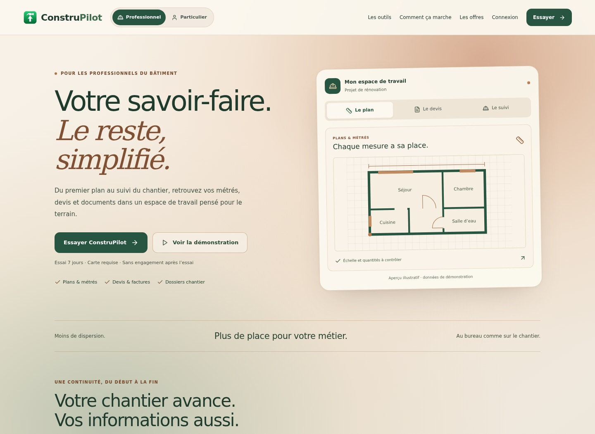
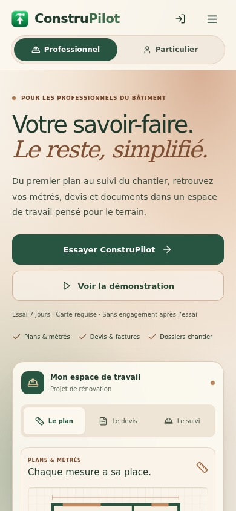
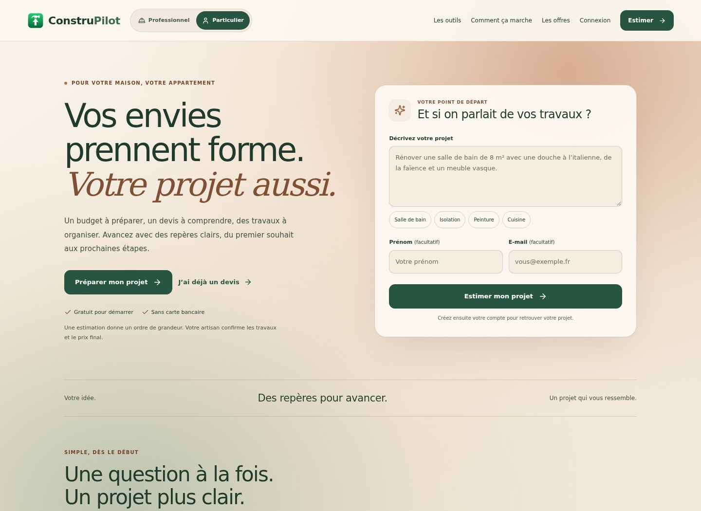
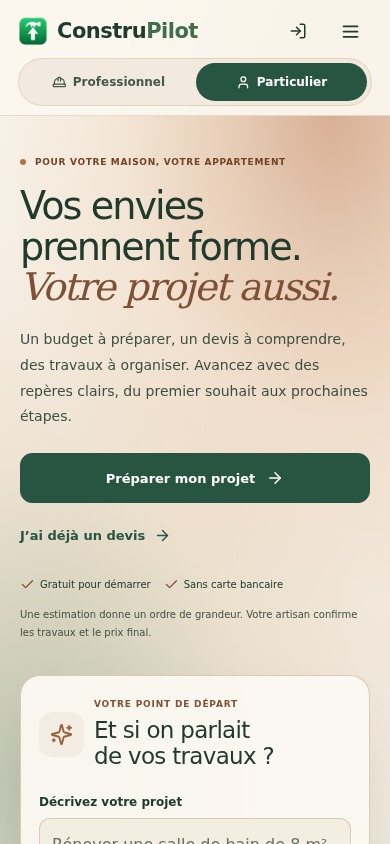

# Pages de présentation Pro et Particuliers

## Changements

Les pages publiques `/` et `/particuliers` partagent désormais un cadre visuel beige chaud, cuivre et vert, avec le fond animé déjà utilisé dans la plateforme. Les titres, espaces, cartes et appels à l’action ont été repensés pour rendre chaque parcours plus clair sur ordinateur et téléphone.

- En-tête responsive commun, accès à la connexion, choix Pro/Particulier et menu mobile ; liens vers les outils, le fonctionnement et les offres.
- Pro : présentation du parcours plans → devis → suivi, aperçu interactif illustratif, fiches des outils et démonstrations vidéo à la demande.
- Particuliers : formulaire de projet mieux hiérarchisé, exemples sélectionnables, champs facultatifs explicitement indiqués, explication du caractère indicatif de l’estimation.
- Offres, prix, destinations des outils, liens légaux, URL canoniques et choix d’audience existants conservés.
- Pied de page commun ; commande de pause du fond mémorisée et respect de la réduction des animations demandée par le système.
- Palette claire limitée aux pages publiques : le thème du compte reste intact en entrant et en sortant de ces pages.

L’aperçu Pro affiche des données de démonstration identifiées comme telles. Les textes de présentation ne promettent pas une précision de lecture validée ni une absence d’erreur.

## Corrections de parcours

Le formulaire Particuliers s’appuie maintenant sur `AuthContext` au lieu de chercher un cookie de session dans `document.cookie`. Un cookie httpOnly étant illisible par JavaScript, l’ancien contrôle pouvait renvoyer un utilisateur déjà connecté vers l’inscription. Le bouton attend la résolution de l’authentification, puis dirige vers l’estimateur ou l’inscription selon l’état réel du contexte.

Le brouillon du projet, les coordonnées facultatives, le prospect en attente et les paramètres UTM conservent leurs clés de stockage existantes. Une erreur de stockage affiche un message et conserve la saisie sur place. Le formulaire utilise la validation native du champ e-mail. Aucun endpoint de production n’a été appelé pendant les vérifications.

Le compteur invisible qui continuait à interroger le serveur a été retiré. Les composants vidéo sont montés lorsque le visiteur ouvre les démonstrations, puis démontés lorsqu’il les referme.

## Vérifications

- Analyse statique de 407 fichiers JavaScript/JSX : aucune erreur de syntaxe ou de nom non défini détectée.
- Pages réelles compilées et exécutées dans Chromium, avec authentification, permissions et API simulées localement.
- Affichage à 320, 390, 768 et 1440 px, sans débordement horizontal ; inspection visuelle des aperçus ordinateur et mobile.
- Choix d’audience et mémorisation, titres et URL canoniques, menu mobile, focus du formulaire, navigation clavier et fermeture des fenêtres avec Échap.
- Aperçu interactif, ouverture des outils, démonstrations à la demande, liens des offres et de connexion.
- Formulaire anonyme et connecté, attente d’authentification, validation e-mail, stockage indisponible, conservation du projet et des paramètres UTM.
- Pause du fond persistante et conservation du thème du compte. Aucune erreur JavaScript de page observée pendant ces scénarios.

Script de reproduction : `frontend/scripts/test-landing-presentations.cjs`. Il utilise les dépendances de développement esbuild, Tailwind CSS et Playwright. `CHROMIUM_EXECUTABLE_PATH` permet de choisir le navigateur ; `LANDING_PREVIEW_DIR` permet de choisir le dossier des captures. Les médias utilisés par le scénario sont des fixtures locales et ne valident pas la disponibilité des vidéos de production.

Il s’agit de vérifications ciblées sur ces deux pages, avec services simulés. Aucun build de production complet, test sur téléphone physique, appel réel d’inscription ou de paiement, ni déploiement n’a été effectué pour ce lot. Les réserves des rapports précédents sur les métrés et la validation globale restent applicables.

## Aperçus

### Professionnels

### Particuliers

